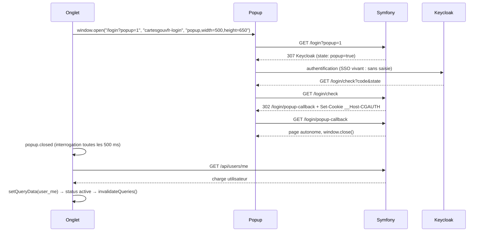

# Authentification

L'application utilise un **BFF stateless** (Backend-for-Frontend) : le backend Symfony gère intégralement le flux OAuth2/OIDC avec Keycloak et stocke les tokens dans un **cookie HttpOnly chiffré** posé sur le navigateur. Le frontend React n'a jamais accès aux tokens.

Aucune session PHP n'est utilisée (le bloc `session:` est absent de `config/packages/framework.yaml`, les deux firewalls sont `stateless: true`).

---

## Le cookie `__Host-CGAUTH`

| Attribut   | Valeur                                                                                             |
| ---------- | -------------------------------------------------------------------------------------------------- |
| Nom        | `__Host-CGAUTH` (préfixe `__Host-` imposé par le navigateur : `Secure`, `Path=/`, pas de `Domain`) |
| `HttpOnly` | oui — inaccessible au JavaScript                                                                   |
| `Secure`   | oui — HTTPS uniquement                                                                             |
| `SameSite` | `Lax`                                                                                              |
| `Expires`  | aligné sur `access_token.expires` de Keycloak                                                      |

**Contenu** : `serialize(AccessToken)` → `gzdeflate` → chiffré avec **XSalsa20-Poly1305** (libsodium) → `base64url`.

La clé de chiffrement est dérivée de `APP_SECRET` via **HKDF-SHA256** avec l'info `cgfr.auth-cookie.v1`. Elle ne change que si `APP_SECRET` change (voir [Points de vigilance](#points-de-vigilance)).

→ [`src/Security/Cookie/AuthCookieCipher.php`](../../../src/Security/Cookie/AuthCookieCipher.php)

---

## Flux de login

```
Navigateur         Symfony               Keycloak
    |                  |                     |
    |-- GET /login --> |                     |
    |                  |-- build state ------+
    |                  |   (HMAC-signé)      |
    |<-- 307 redirect -+-------------------> |
    |                                        |
    |-- callback GET /login/check?code=X&state=Y -->
    |                  |                     |
    |                  |-- exchange code --> |
    |                  |<-- AccessToken ---- |
    |                  |                     |
    |                  | setAccessToken()    |
    |                  | (intent sur la req) |
    |                  |                     |
    |<-- 302 + Set-Cookie: __Host-CGAUTH ----+
    |                                        |
```

1. **`GET /login`** ([`SecurityController::login()`](../../../src/Controller/SecurityController.php)) construit le paramètre `state` HMAC-signé (voir [Paramètre `state`](#paramètre-state)) et redirige vers Keycloak.
2. Keycloak authentifie l'utilisateur, puis rappelle **`GET /login/check?code=…&state=…`**.
3. [`KeycloakAuthenticator`](../../../src/Security/KeycloakAuthenticator.php) valide le `state`, échange le code contre un `AccessToken` via KnpU, et appelle `KeycloakTokenManager::setAccessToken()`.
4. [`KeycloakTokenManager::setAccessToken()`](../../../src/Security/KeycloakTokenManager.php) pose un **intent** dans les attributs de la requête.
5. [`AuthCookieResponseListener`](../../../src/Security/Cookie/AuthCookieResponseListener.php) intercepte l'événement `kernel.response`, lit l'intent et pose le cookie chiffré sur la réponse.
6. `KeycloakAuthenticator::onAuthenticationSuccess()` redirige vers la page d'origine (via `referer` stocké dans `state`).

**Variante popup** (reconnexion depuis une page ouverte, voir [Expiration de session](#expiration-de-session-ux-frontend)) : le front ouvre `GET /login?popup=1` dans une fenêtre popup. Le `state` porte alors `popup: true` et, succès comme échec, `/login/check` redirige vers **`GET /login/popup-callback`** : une page HTML autonome (sans bundle React, `Cache-Control: no-store`) dont le seul script est `window.close()`. Le cookie est posé sur la réponse de `/login/check` comme dans le flux normal ; la popup et l'onglet d'origine partagent le même cookie. Deux garde-fous dans [`KeycloakAuthenticator`](../../../src/Security/KeycloakAuthenticator.php) : un `state` signé mais expiré (plus de 5 min sur le formulaire Keycloak) garde sa cible popup au lieu d'afficher l'application entière dans la fenêtre ; un échec sans jeton reçu (échange de code refusé, `state` expiré) ne vide pas le cookie, qui peut être celui, encore valable, de l'onglet d'origine.

---

## Flux d'une requête authentifiée

```
Navigateur              Symfony
    |                      |
    |-- GET /xyz -----------+
    |   Cookie: __Host-CGAUTH=...
    |                      |
    |                      | ApiFetchMetadataGuard (routes d'API seulement)
    |                      |   → 403 si Sec-Fetch-Site cross-site/same-site ou Sec-Fetch-Mode navigate
    |                      |   → sans Fetch Metadata : X-Requested-With exigé
    |                      |
    |                      | CookieAuthenticator::supports() → true (cookie présent)
    |                      | CookieAuthenticator::authenticate()
    |                      |   → KeycloakTokenManager::getAccessToken()
    |                      |      → déchiffrer cookie → unserialize → AccessToken
    |                      |      → mise en cache dans request.attributes
    |                      |   → vérifier token non expiré
    |                      | KeycloakUserProvider::loadUser()
    |                      |   → User depuis la réponse userinfo (1 appel / 60 s / jeton, en cache)
    |                      |
    |                      | Controller → AuthenticatedHttpClient
    |                      |   → getAccessToken() → header Authorization: Bearer <token>
    |                      |   → appel API Entrepôt
    |<-- réponse -----------+
```

### Frontière API

Une route est une route d'API si son chemin correspond au paramètre `app.api_path_pattern` (`config/services.yaml`) : `/api/*` et `/contact_us`. Ce motif est la seule règle ; il alimente le firewall `api`, le contrôle d'accès, la garde Fetch Metadata et le rendu des erreurs en `application/problem+json`.

Deux firewalls (`config/packages/security.yaml`) :

- **`api`** (motif) : `CookieAuthenticator` seul, `ROLE_USER` exigé par `access_control` (sauf `/contact_us`, appelé sans cookie par le formulaire du site de documentation, et `/api/doc` en dev). Sans cookie valide, le point d'entrée [`ApiAuthenticationEntryPoint`](../../../src/Security/ApiAuthenticationEntryPoint.php) produit l'unique 401 : `type` `/errors/anonymous`, `detail` « Connexion requise ». Un cookie expiré est effacé sur cette réponse. Jamais de redirection.
- **`main`** (le reste : pages, `/login`, `/logout`, `/files`, `/rss`) : `CookieAuthenticator` + `KeycloakAuthenticator`. Cookie expiré sur une page → redirect `GET /login?session_expired=1` + effacement du cookie.

[`ApiFetchMetadataGuard`](../../../src/Listener/ApiFetchMetadataGuard.php) (`kernel.request`, avant le firewall) refuse en 403 les appels d'API venus d'un autre site (`Sec-Fetch-Site` `cross-site` ou `same-site`) et les navigations (`Sec-Fetch-Mode` `navigate`) ; sans en-têtes Fetch Metadata, il exige `X-Requested-With: XMLHttpRequest`, envoyé par `jsonFetch`. Le cookie `SameSite=Lax` reste la première protection, la garde la seconde.

---

## Identité, profil Entrepôt et cache par pod

[`User`](../../../src/Security/User.php) est le principal Keycloak seul : `id` (claim `sub`, identique à l'identifiant utilisateur de l'Entrepôt), e-mail, nom d'utilisateur, prénom, nom, `session_expires_at`. [`KeycloakUserProvider`](../../../src/Security/KeycloakUserProvider.php) le reconstruit à chaque requête depuis la réponse userinfo de Keycloak, en cache 60 s par jeton (`keycloak-user-*` dans `cache.app`). `getUserIdentifier()` renvoie l'e-mail. Une panne Entrepôt n'empêche ni la connexion ni les pages publiques.

Keycloak fait autorité sur l'état de la session : ce même appel userinfo répond 401 dès que la session est fermée ou le compte désactivé → 401 et cookie effacé au plus tard 60 s après ; Keycloak injoignable → même refus (fermeture par défaut). Un échec à `/login/check` (jeton reçu puis refusé par userinfo) ne pose jamais le cookie du jeton refusé.

`MembershipService` refuse (500 explicite) un profil Entrepôt dont `_id` n'est pas le `sub` Keycloak : les comparaisons d'appartenance et l'ajout au bac à sable reposent sur cette égalité.

Le profil Entrepôt (corps brut de `GET users/me`, mis en cache 60 s par identifiant dans [`EntrepotUserCache`](../../../src/Services/EntrepotUserCache.php), pool `cache.app`) n'est lu que par [`MembershipService`](../../../src/Services/MembershipService.php), qui en dérive les infos datastore/communauté (nom, `technical_name`, id de communauté) au lieu de les recharger via l'API. Vocabulaire : [glossaire](../glossaire.md).

[`CurrentUserPayload`](../../../src/Services/CurrentUserPayload.php) assemble la charge envoyée au front, identique dans la page (`#user`, amorçage de React Query) et dans `GET /api/users/me` : identité Keycloak (`email`, `user_name`, `first_name`, `last_name`, `roles`, qui priment sur la copie Entrepôt), profil Entrepôt dans la structure de l'API Entrepôt (`_id`, `communities_member`, quotas…), `session_expires_at`. Une panne Entrepôt y répond 503 (Problem Details ou page d'erreur) : pas de rendu dégradé avec une liste d'entrepôts vide.

Trois mécanismes limitent la fenêtre de péremption du profil :

- **Invalidation** après une mutation d’appartenance faite par l’utilisateur lui-même (quitter une communauté, ajout au bac à sable, modification de ses droits ou de sa communauté) : l’entrée est supprimée, la requête suivante recharge.
- **Rafraîchissement explicite** sur `GET /api/users/me?refresh=1` : le front le demande juste après un changement d'appartenance (ajout au bac à sable) ; l'entrée du cache est réécrite.
- **Deny-path** : quand une appartenance n’est pas trouvée, une revalidation forcée est tentée avant de conclure, au plus une fois par 10 s (`fetched_at` stocké dans l’entrée).

En production, `cache.app` est APCu, donc **propre à chaque pod** ; Kubernetes exécute plusieurs réplicas sans affinité de session. Conséquences, acceptées :

| Mécanisme                  | Portée          | Effet avec N pods                                                                   |
| -------------------------- | --------------- | ----------------------------------------------------------------------------------- |
| Invalidation               | le pod mutateur | les autres pods gardent l’entrée périmée jusqu’à 60 s                               |
| Rafraîchissement explicite | le pod servant  | frais quel que soit le pod, et répare le cache de ce pod                            |
| Deny-path                  | le pod servant  | une appartenance manquante est revérifiée sur n’importe quel pod (≤ 1 appel / 10 s) |

Sans `?refresh=1`, `GET /api/users/me` sert l’entrée du pod : la liste des entrepôts peut retarder de 60 s après un changement fait sur un autre pod. Le sens « obtention d’un accès » est couvert sur tous les pods là où le front le demande. Le sens « retrait d’un accès » ne l’est volontairement pas : seuls des champs dérivés (noms, ids) sont concernés, l’API Entrepôt fait autorité, et une péremption ≤ 60 s existe déjà sur un seul pod. Aucun cache partagé (Redis) n’est prévu pour cela.

---

## Flux de logout

```
Navigateur              Symfony               Keycloak
    |                      |                     |
    |-- GET /logout ------> |                     |
    |                      | LogoutSubscriber::onLogout()
    |                      |   → getIdToken()    |
    |                      |   → clearAccessToken() (intent CLEAR sur la req)
    |                      |                     |
    |                      | kernel.response     |
    |                      |   → AuthCookieResponseListener
    |                      |      → Set-Cookie: __Host-CGAUTH=; Max-Age=0
    |                      |                     |
    |<-- 302 + cookie vide -+---> end_session_endpoint?id_token_hint=…&post_logout_redirect_uri=…
    |                                            |
    |<-- redirect vers /decouvrir ---------------+
```

[`LogoutSubscriber`](../../../src/Listener/LogoutSubscriber.php) récupère l'`id_token` depuis le token manager, déclenche l'effacement du cookie via `clearAccessToken()` (intent `__clear__`), puis redirige vers le `end_session_endpoint` Keycloak avec `id_token_hint` pour invalider la session SSO côté fournisseur.

Si l'utilisateur est déjà anonyme (cookie absent), `getIdToken()` retourne `null` : le `LogoutSubscriber` redirige directement vers `/publier-une-donnee` sans appeler Keycloak.

---

## Paramètre `state` OAuth2

Le `state` remplace le stockage de contexte en session PHP. C'est un blob `base64url(json).base64url(hmac)` signé avec HKDF-SHA256 (`cgfr.login-state.v1`), valable **5 minutes**.

| Clé               | Contenu                                                                                                                                                                                                           |
| ----------------- | ----------------------------------------------------------------------------------------------------------------------------------------------------------------------------------------------------------------- |
| `referer`         | URL de la page depuis laquelle le login a été déclenché, pour y rediriger après succès                                                                                                                            |
| `session_expired` | `"1"` si le login a été déclenché par une expiration de session, pour afficher un message approprié                                                                                                               |
| `popup`           | `true` si le login a été ouvert dans la popup de reconnexion : succès et échec redirigent vers `/login/popup-callback`                                                                                            |
| `nonce`           | 16 octets aléatoires en hex — entropie pour que chaque state ait une signature HMAC distincte. Il n'y a pas de nonce serveur à usage unique (design stateless) ; la fenêtre de rejeu est bornée par `exp` (5 min) |
| `exp`             | Timestamp d'expiration Unix (+5 min) — le state ne peut pas être réutilisé indéfiniment                                                                                                                           |

La vérification HMAC avec `hash_equals` protège contre les forgeries. `verify()` rend la charge d'un `state` signé, expiré ou non ; `decode()` y ajoute le contrôle d'expiration. L'authenticator vérifie d'abord la signature et garde la charge, puis refuse un `state` expiré : l'échec connaît encore sa cible (`popup`). La clé `use_state: false` dans `knpu_oauth2_client.yaml` désactive la gestion native du state par le bundle : on gère entièrement le nôtre.

→ [`src/Security/State/LoginStateSerializer.php`](../../../src/Security/State/LoginStateSerializer.php)

---

## Expiration de session (UX frontend)

Le navigateur supprime le cookie en même temps que le token expire : le serveur ne distingue pas « session expirée » de « jamais connecté » et répond le même 401 en Problem Details (RFC 9457) :

```json
{ "title": "Unauthorized", "status": 401, "detail": "Connexion requise", "details": [], "type": "/errors/anonymous" }
```

C'est donc le front qui connaît l'expiration, par `session_expires_at` (secondes Unix, `expires` du jeton d'accès) dans la charge utilisateur. Le cookie expire à la même heure.

### États

Le store [`SessionStore`](../../../assets/stores/SessionStore.ts) (zustand) porte `{ status, expiresAt }` avec trois statuts :

| Statut      | Condition                                          | Effet                                                                                                                                                            |
| ----------- | -------------------------------------------------- | ---------------------------------------------------------------------------------------------------------------------------------------------------------------- |
| `anonymous` | charge `#user` absente                             | `useUserQuery` désactivé : aucun appel à `/api/users/me` (un visiteur ne devient connecté que par une navigation complète)                                       |
| `active`    | avant `expiresAt`                                  | fonctionnement normal                                                                                                                                            |
| `expired`   | `expiresAt` atteint, ou 401 reçu en session connue | alerte `error` « Session expirée » ; `useUserQuery` désactivé, le dernier utilisateur reste en cache, la page reste montée (la garde du routeur ne redirige pas) |

Entrées du store :

- la charge `#user` au démarrage et chaque réponse de `/api/users/me` (`applyUser`, fixe `expiresAt` et recalcule le statut, dans un sens comme dans l'autre : la dernière réponse du serveur gagne) ;
- l'horloge : une minuterie vers `expiresAt`, plus un recalcul sur `focus` et `visibilitychange` (les onglets en arrière-plan brident les minuteries). L'horloge ne fait qu'avancer : elle ne ramène jamais un `expired` reçu du serveur en `active` ;
- tout 401 reçu par [`apiFetch`](../../../assets/modules/jsonFetch.ts) alors qu'un utilisateur est connu (déclencheur de secours, `markExpired`), sans effet en `anonymous`.

Le module [`session.ts`](../../../assets/modules/session.ts) tient l'horloge, la popup et la vérification directe ; `startSessionClock()` est appelé une fois dans `App.tsx`, après `bootstrapUser()`. Une mutation qui a échoué sur un 401 n'est pas rejouée : l'utilisateur re-soumet après reconnexion.

### Reconnexion par popup

L'alerte [`SessionAlert`](../../../assets/components/Utils/SessionAlert.tsx) (DSFR, non fermable, sous le fil d'Ariane de `Main` et `DatastoreMain`, sur toute page) porte un bouton « Se reconnecter » qui appelle `reconnect()` dans le gestionnaire de clic :



- `window.open` renvoie `null` (popup bloquée) : `location.assign("/login")`, connexion dans l'onglet, retour par le `referer`.
- Popup déjà ouverte : `focus()` dessus, pas de seconde fenêtre. Mobile ou réglage navigateur ouvrant un onglet au lieu d'une fenêtre : même code.
- À la fermeture, `checkSession()` relit `/api/users/me` : utilisateur → `setQueryData`, puis statut `active` (la requête utilisateur se réactive), puis `invalidateQueries()` sans filtre, dans cet ordre ; 401 → reste `expired`, le bouton reste cliquable (pas de compteur, pas de délai de garde) ; erreur réseau ou amont → état inchangé. Une relecture encore en cours est abandonnée quand une nouvelle popup s'ouvre.
- `invalidateQueries()` marque aussi `user_me` invalide : à sa réactivation la requête se relance malgré `staleTime`, soit un second `GET /api/users/me` juste après celui de `checkSession()`, servi par le cache serveur.
- Autres onglets : un onglet qui affiche « Session expirée » le garde jusqu'à son propre clic sur « Se reconnecter » (avec un SSO vivant, sa popup se referme aussitôt). Entre-temps, ses appels d'API passent déjà avec le cookie posé par l'autre onglet : seule une réponse de `/api/users/me` ramène le store en `active`, et `useUserQuery` est désactivé en `expired`. Voulu : un clic par onglet plutôt qu'une revérification serveur au retour de focus.
- Pas de `postMessage`, pas de `noopener` : la fermeture de la fenêtre est le signal. Un futur en-tête `Cross-Origin-Opener-Policy` devra valoir `same-origin-allow-popups`, et une CSP devra autoriser le `<script>` inline de la page de retour (nonce).
- Décalage d'horloge : le front compare `session_expires_at` (heure serveur) à l'horloge du poste ; un poste en avance de X voit l'alerte X plus tôt, la reconnexion corrige.
- `iam_login_disabled` : la popup affiche la page « connexion désactivée », voulue (maintenance du SSO).

---

## Composants clés

| Fichier                                                                                                             | Rôle                                                                        |
| ------------------------------------------------------------------------------------------------------------------- | --------------------------------------------------------------------------- |
| [`src/Security/Authenticator/CookieAuthenticator.php`](../../../src/Security/Authenticator/CookieAuthenticator.php) | Authenticator principal : lit et valide le cookie sur chaque requête        |
| [`src/Security/KeycloakAuthenticator.php`](../../../src/Security/KeycloakAuthenticator.php)                         | Authenticator OAuth2 : gère le callback `/login/check` et le flux OIDC      |
| [`src/Security/ApiAuthenticationEntryPoint.php`](../../../src/Security/ApiAuthenticationEntryPoint.php)             | Point d'entrée du firewall `api` : l'unique 401 des routes d'API            |
| [`src/Listener/ApiFetchMetadataGuard.php`](../../../src/Listener/ApiFetchMetadataGuard.php)                         | Garde Fetch Metadata des routes d'API (403 autre site ou navigation)        |
| [`src/Security/Cookie/AuthCookieCipher.php`](../../../src/Security/Cookie/AuthCookieCipher.php)                     | Chiffrement/déchiffrement XSalsa20-Poly1305 + HKDF                          |
| [`src/Security/Cookie/AuthCookieResponseListener.php`](../../../src/Security/Cookie/AuthCookieResponseListener.php) | Pose ou efface le cookie sur `kernel.response` selon l'intent               |
| [`src/Security/KeycloakTokenManager.php`](../../../src/Security/KeycloakTokenManager.php)                           | Accès centralisé au token (lecture cookie, cache requête, intent set/clear) |
| [`src/Security/State/LoginStateSerializer.php`](../../../src/Security/State/LoginStateSerializer.php)               | Encode/décode le paramètre `state` OAuth2 signé HMAC                        |
| [`src/Security/KeycloakUserProvider.php`](../../../src/Security/KeycloakUserProvider.php)                           | Reconstruit `User` depuis userinfo Keycloak (cache 60 s, session vérifiée) |
| [`src/Services/EntrepotUserCache.php`](../../../src/Services/EntrepotUserCache.php)                                 | Cache serveur (60 s) de `GET users/me`, invalidation et rafraîchissement    |
| [`src/Services/MembershipService.php`](../../../src/Services/MembershipService.php)                                 | Seul accès au profil Entrepôt ; dérivation datastore/communauté, deny-path  |
| [`src/Services/CurrentUserPayload.php`](../../../src/Services/CurrentUserPayload.php)                               | Charge utilisateur du front (`#user` et `/api/users/me`)                    |
| [`src/Controller/SecurityController.php`](../../../src/Controller/SecurityController.php)                           | Routes `/login`, `/logout`, `/login/check`, `/login/popup-callback`         |
| [`src/Listener/LogoutSubscriber.php`](../../../src/Listener/LogoutSubscriber.php)                                   | Récupère l'`id_token` et déclenche la déconnexion SSO Keycloak              |
| [`src/ApiClient/Auth/AuthenticatedHttpClient.php`](../../../src/ApiClient/Auth/AuthenticatedHttpClient.php)         | Injecte `Authorization: Bearer` sur les appels sortants vers l'Entrepôt     |
| [`assets/modules/jsonFetch.ts`](../../../assets/modules/jsonFetch.ts)                                               | Envoie `X-Requested-With`, signale les 401 au store de session              |
| [`assets/stores/SessionStore.ts`](../../../assets/stores/SessionStore.ts)                                           | État de session du front : anonyme, active, expirée                         |
| [`assets/modules/session.ts`](../../../assets/modules/session.ts)                                                   | Horloge de session, popup de reconnexion, relecture de `/api/users/me`      |
| [`assets/components/Utils/SessionAlert.tsx`](../../../assets/components/Utils/SessionAlert.tsx)                     | Alerte « Session expirée », bouton Se reconnecter                           |
| [`config/packages/security.yaml`](../../../config/packages/security.yaml)                                           | Firewalls `api` et `main`, `stateless: true`, contrôle d'accès              |

---

## Paramètres et variables d'environnement

| Paramètre            | Source                     | Rôle                                                      |
| -------------------- | -------------------------- | --------------------------------------------------------- |
| `APP_SECRET`         | `.env` / secret Kubernetes | Dérivation des clés HKDF (cookie + state). **Critique.**  |
| `iam_base_url`       | `config/parameters.yaml`   | URL base du serveur Keycloak                              |
| `iam_realm`          | `config/parameters.yaml`   | Realm Keycloak                                            |
| `iam_client_id`      | secret                     | Client ID OAuth2                                          |
| `iam_client_secret`  | secret                     | Client secret OAuth2                                      |
| `iam_login_disabled` | `config/parameters.yaml`   | Si `true`, redirige `/login` vers `/connexion-desactivee` |

---

## Points de vigilance

**Rotation de `APP_SECRET`** : toute rotation invalide immédiatement tous les cookies en cours (HKDF change → déchiffrement échoue → tous les utilisateurs sont déconnectés). Prévoir une fenêtre de maintenance ou une double-clé si nécessaire.

**Préfixe `__Host-`** : le navigateur n'accepte ce préfixe que si la réponse provient d'une connexion HTTPS. En développement local HTTP (`localhost`), le cookie est refusé — utiliser `https://cartesgouvfr-dev.docker.localhost` via Traefik.

**Taille du cookie** : les JWT Keycloak avec beaucoup de rôles/groupes peuvent être volumineux. La compression `gzdeflate` (niveau 6) est indispensable pour rester sous la limite navigateur de ~4 ko par cookie. Ne pas la retirer sans mesurer la taille réelle pour les comptes administrateurs.

**Garde Fetch Metadata** : un appel d'API doit venir de la même origine. Le site de documentation (`/aide`, même origine) passe ; une brique servie depuis un sous-domaine serait refusée (`same-site`) et devrait être autorisée explicitement. Un `EventSource` natif ne peut pas envoyer `X-Requested-With` : il ne passe que par `Sec-Fetch-Site: same-origin`, donc pas sur un navigateur sans Fetch Metadata.

**`/contact_us` public** : seule route d'API appelable sans cookie, n'importe qui peut y déclencher l'envoi de courriels ; à restreindre.

**Popup de reconnexion** : le login dans la popup partage le cookie de l'onglet d'origine. Tout changement du flux d'échec (`onAuthenticationFailure`) doit garder la règle « pas de jeton reçu, pas de cookie effacé », sinon un échec dans la popup efface un cookie encore valable : celui qu'un autre onglet vient de poser en se reconnectant (l'onglet courant garde son alerte jusqu'à son propre clic), ou celui d'un poste dont l'horloge avance.

**Pas de session PHP** : le bloc `session:` est intentionnellement absent de `config/packages/framework.yaml`. Ne pas le réintroduire pour des fonctionnalités annexes (flash, CSRF, etc.) sans réévaluer l'architecture stateless.
