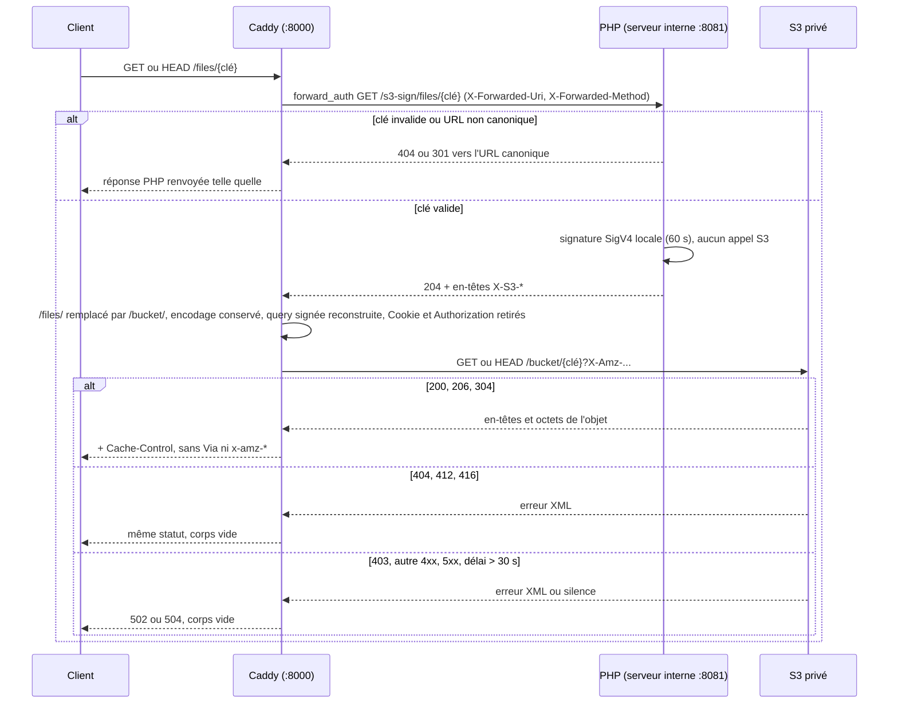

# Passerelle S3 (`/files/{clé}`)

Sert en lecture seule, à une URL propre et sur le domaine du site, n'importe quel objet du bucket S3 privé (images et documents des actualités moissonnées, ou tout autre contenu déposé par d'autres services). Le bucket, son endpoint et ses identifiants ne sont jamais exposés.

## Flux d'une requête



1. Caddy reçoit `GET` ou `HEAD /files/{clé}` (bloc `route @s3Gateway` de `.docker/Caddyfile`). Les autres méthodes suivent le chemin habituel vers PHP, comme avant.
2. `forward_auth` envoie une sous-requête `GET /s3-sign/files/{clé}` au serveur interne `http://127.0.0.1:8081`, joignable uniquement en boucle locale, qui exécute `CartesS3Controller::sign()`. Ce préfixe `/s3-sign/` est la seule route Symfony de la passerelle ; le site public répond 404 dessus, Symfony ne sachant pas par quel serveur Caddy une requête arrive.
3. Le contrôleur rejette en 404 une clé vide, de plus de 1024 octets, contenant un caractère de contrôle ou un segment `..`. Si l'URL publique brute (`X-Forwarded-Uri`) n'est pas canonique, il répond 301 vers sa forme canonique : segments vides ou `.` retirés (Flysystem les ignorait, le S3 non) et `+` brut encodé en `%2B` (le S3 le lit comme une espace).
4. Il signe une requête S3 pour cette clé et la méthode du client (`X-Forwarded-Method`, GET ou HEAD) avec `AsyncAws\S3\S3Client`, validité 60 s. La signature est un calcul local : PHP n'appelle jamais le S3. Il répond 204 avec les paramètres signés dans des en-têtes `X-S3-*`.
5. Sur un 2xx, Caddy recopie ces en-têtes sur la requête du client, remplace le préfixe `/files/` par le nom du bucket sans toucher à l'encodage du chemin, reconstruit la query signée, retire `Cookie`, `Authorization` et les `X-S3-*`, puis relaie vers `S3_ENDPOINT`. Sur un autre statut (404, 301), la réponse PHP est renvoyée telle quelle.
6. Les octets transitent par Caddy, sans occuper de thread PHP.

`ETag`, `Last-Modified`, `Content-Type`, `Content-Length`, les réponses 206 (`Range`) et 304 (`If-None-Match`, `If-Modified-Since`) viennent du S3 tels quels. Caddy ajoute `Cache-Control: public, max-age=3600, must-revalidate, s-maxage=3600` sur les 200, 206 et 304 uniquement, `Content-Security-Policy: sandbox` sur toutes les réponses (un objet HTML ou SVG ouvert directement dans le navigateur ne peut exécuter de script sur l'origine du site ; sans effet sur les `fetch()` du site éditorial ni sur les images), et retire `Via` et les en-têtes `x-amz-*`.

## Statuts

| Cas                                                                     | Réponse                                                                                                      |
| ----------------------------------------------------------------------- | ------------------------------------------------------------------------------------------------------------ |
| Clé invalide (vide, trop longue, caractère de contrôle, `..`)           | 404 vide, décidée par PHP                                                                                    |
| URL non canonique (`+` brut, segment vide ou `.`, barre oblique finale) | 301 vers l'URL canonique                                                                                     |
| `..` en tête de clé, `/files` ou `/files/`                              | hors passerelle : page React, comme pour toute URL inconnue (Caddy résout les segments `..` avant de router) |
| Objet absent (404 S3)                                                   | 404 vide                                                                                                     |
| `If-Match` ou `If-Unmodified-Since` non satisfait (412 S3)              | 412 vide                                                                                                     |
| `Range` hors de l'objet (416 S3)                                        | 416 vide avec `Content-Range`                                                                                |
| Identifiants invalides (403 S3) ou autre erreur S3 (4xx, 5xx)           | 502 vide                                                                                                     |
| S3 ou proxy sortant injoignable                                         | 502 vide                                                                                                     |
| S3 muet plus de 30 s avant les en-têtes de réponse                      | 504 vide                                                                                                     |

Les erreurs portent `Cache-Control: no-cache, private` (comme les 404 de l'ancien contrôleur), pas d'en-tête `Server`, et jamais le XML du S3 (qui contient le nom du bucket).

## Pourquoi forward_auth et pas X-Accel-Redirect

Le relais doit envoyer au S3 le chemin exactement comme le client l'a encodé : `rewrite` décode puis ré-encode le chemin selon les règles de Go, qui laissent `+` brut, et le S3 lit alors une espace. `forward_auth` laisse l'URL du client intacte (seule la sous-requête interne est réécrite, et PHP n'a besoin que de la clé décodée), `uri replace` conserve l'encodage brut, et seule la query signée est reconstruite (chaque valeur est encodée par `rewrite`). Les noms d'en-têtes dans les placeholders sont en forme canonique (`X-S3-Signedheaders`).

## Logs

PHP répond avant l'appel S3 : seul Caddy connaît le statut final. Les requêtes `/files/*` sont donc loggées par l'access log Caddy (exception au `log_skip` des requêtes dynamiques) et ignorées par `AccessLogSubscriber`. Le serveur interne (`http://:8081`, `bind 127.0.0.1`) n'a pas d'access log. Un 404 n'est pas une erreur applicative : il n'apparaît que dans l'access log. Ne jamais activer l'option globale `debug` de Caddy en production : elle journalise les URL signées.

## Prérequis d'environnement

- `S3_ENDPOINT`, `S3_BUCKET_NAME`, `S3_ACCESS_KEY`, `S3_SECRET_KEY` : lus par PHP (signature) et par Caddy (`{$S3_ENDPOINT}` et `{$S3_BUCKET_NAME}` dans le Caddyfile).
- `HTTPS_PROXY` : Caddy respecte les mêmes variables de proxy que PHP (comportement Go standard) ; la boucle locale n'est jamais proxifiée.

Le Caddyfile est embarqué dans l'image : une modification se teste en dev en le recopiant dans le conteneur (`docker exec -u root ... cp`) puis en redémarrant celui-ci (`admin off`, pas de rechargement à chaud).

## Vérification manuelle

```sh
B=http://localhost:9092
curl -sI $B/files/articles/articles-scraper-cronjob-history.json          # 200, ETag, Cache-Control
curl -sI -H "Range: bytes=0-9" $B/files/articles/...                       # 206
curl -sI -H 'If-None-Match: "<etag>"' $B/files/articles/...               # 304
curl -sI -H "Range: bytes=99999999-" $B/files/articles/...                 # 416, sans XML
curl -s -o /dev/null -w "%{http_code}\n" --path-as-is $B/files/a%09b       # 404 (PHP)
curl -s -o /dev/null -w "%{http_code}\n" --path-as-is $B/files/a+b         # 301 vers /files/a%2Bb
curl -s -o /dev/null -w "%{http_code}\n" --path-as-is $B/files/articles/./x # 301 vers /files/articles/x
curl -s -o /dev/null -w "%{http_code}\n" $B/files/absent.txt               # 404 (S3)
```

Un `S3_SECRET_KEY` faux doit donner 502. Les cas limites (encodages de clé, statuts S3, délai amont) se rejouent avec un faux S3 local : voir l'historique de la PR.
