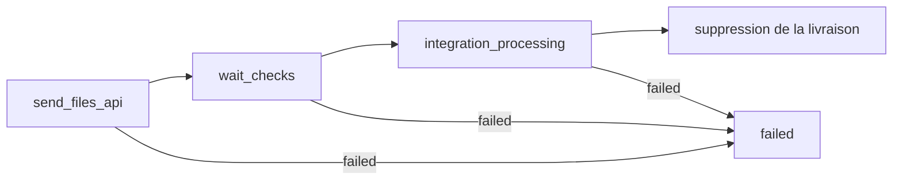

# Workflow : intégration upload vecteur (VECTOR-DB)

Ce document décrit l'intégration d'une livraison vecteur : envoi des fichiers à l'Entrepôt, attente des vérifications, lancement du traitement d'intégration en base, puis suppression de la livraison.

Le navigateur pilote l'intégration : l'utilisateur reste sur la page de suivi. Il n'y a pas de tâche de fond. S'il quitte la page avant le lancement du traitement, l'intégration s'arrête et reprend par « Reprendre l'intégration ». Une fois le traitement lancé, l'Entrepôt termine seul.

## Deux routes

- `GET /api/datastores/{datastoreId}/upload/{uploadId}/integration` : calcule et renvoie l'état. Aucun effet de bord.
- `POST /api/datastores/{datastoreId}/upload/{uploadId}/integration` : exécute la prochaine action en attente, puis renvoie l'état.

L'état n'est stocké nulle part : `UploadIntegrationWorkflow::getState` le recalcule à chaque appel à partir de la livraison, de ses vérifications, de l'exécution du traitement et de la donnée stockée.

```json
{
    "steps": {
        "send_files_api": "successful",
        "wait_checks": "successful",
        "integration_processing": "in_progress"
    },
    "status": "in_progress",
    "next_action": null,
    "vectordb_id": "…",
    "datasheet_name": "…"
}
```

- `status` : statut de la première étape non réussie, `successful` si les trois ont réussi.
- `next_action` : ce que le `POST` exécuterait (`send_files`, `launch_processing`, `delete_upload`), `null` s'il n'y a rien à faire.

## Étapes et règles de statut



Une étape n'est calculée que si la précédente a réussi.

- send_files_api
    - successful : livraison en CLOSED ou CHECKING
    - waiting : livraison en OPEN
    - failed : autre statut

- wait_checks
    - failed : au moins une vérification en FAILED
    - in_progress : au moins une vérification en ASKED ou IN_PROGRESS, ou livraison en CHECKING
    - successful : au moins une vérification en PASSED et aucune en FAILED
    - waiting : aucune vérification lancée et livraison pas en CHECKING

- integration_processing
    - waiting : tags `proc_int_id` et `vectordb_id` absents
    - failed : un seul des deux tags présent
    - in_progress : traitement en CREATED, WAITING ou PROGRESS
    - successful : traitement en SUCCESS et donnée stockée en GENERATED
    - in_progress : traitement en SUCCESS et donnée stockée en CREATED, GENERATING ou MODIFYING
    - failed : autres cas

Le statut de la livraison ne dit pas si les vérifications ont réussi : une livraison passe de CHECKING à CLOSED dans les deux cas (mesuré le 10/11/2026). Seules les exécutions de vérification (`/checks`) font la différence.

## Actions du POST

Une seule action par appel.

| `next_action`       | Condition                                          | Action                                                                             |
| ------------------- | -------------------------------------------------- | ---------------------------------------------------------------------------------- |
| `send_files`        | livraison en OPEN                                  | envoi des fichiers et de leurs md5 à l'Entrepôt, puis fermeture de la livraison    |
| `launch_processing` | vérifications réussies, traitement pas encore créé | création de l'exécution, tags sur la livraison et sur la donnée stockée, lancement |
| `delete_upload`     | les trois étapes ont réussi                        | suppression de la livraison                                                        |

- Envoi des fichiers : pas de limite de temps (`set_time_limit(0)`), un gros fichier dépasse `max_execution_time`.
- Lancement interrompu : si l'écriture des tags ou le lancement échoue, les tags `proc_int_id` et `vectordb_id` sont retirés de la livraison et l'exécution créée est supprimée. Supprimer une exécution non lancée supprime aussi sa donnée stockée de sortie ; l'inverse est refusé (409). L'erreur d'origine remonte.
- Suppression : un échec ne change pas l'état `successful`. La suppression est retentée à la prochaine ouverture de la fiche.

## Verrou

Le `POST` prend un verrou par livraison (`upload_integration_{uploadId}`), sans attendre. Un second appel simultané n'exécute rien et renvoie l'état courant.

Les fichiers verrous sont dans `var/data/locks` (`framework.lock`), sur le volume partagé entre les pods : le verrou vaut pour toute l'application, pas pour un seul pod. Si ce stockage est indisponible, le `POST` répond 503 et n'exécute rien. Le `GET` ne dépend pas du verrou.

## Côté navigateur

- Page de suivi (`DatasheetUploadIntegrationDialog`) : lit le `GET` toutes les 3 secondes et envoie le `POST` dès que `next_action` n'est pas `null`. Jamais deux `POST` à la fois. Après une erreur du `POST`, elle s'arrête et affiche l'erreur.
- Onglet Données (`useUploadIntegrations`) :
    - une livraison sans tag `vectordb_id` n'est pas lancée : sa ligne lit le `GET` pour savoir si une vérification a échoué (« Voir le rapport ») ou non (« Reprendre l'intégration ») ;
    - une livraison dont la donnée stockée est GENERATED n'est pas affichée : l'onglet envoie le `POST` qui la supprime.

## Tags utilisés

- upload
    - data_upload_path
    - datasheet_name
    - producer, producer_short (optionnel), production_year, date, theme, zone, email_notification
    - proc_int_id, vectordb_id : écrits au lancement du traitement
    - file_tree : écrit juste avant la suppression
- stored_data (VECTOR-DB)
    - upload_id
    - proc_int_id
    - datasheet_name
    - producer, producer_short, production_year, date, theme, zone : recopiés de l'upload quand il les porte (`UploadIntegrationWorkflow::forwardedTags`)
